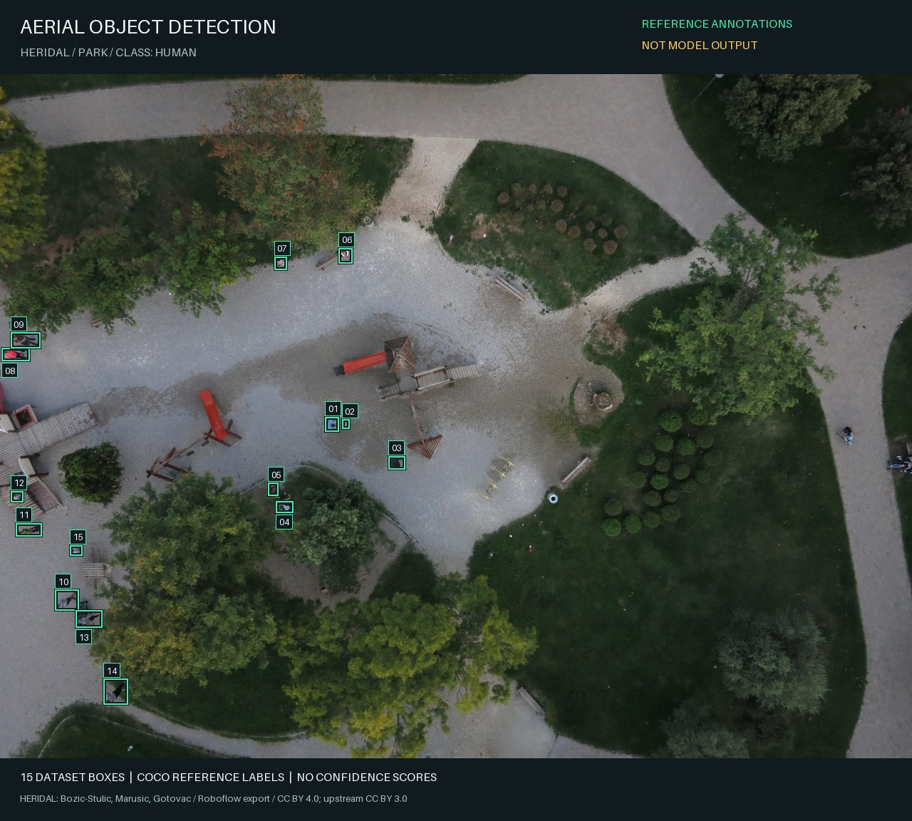
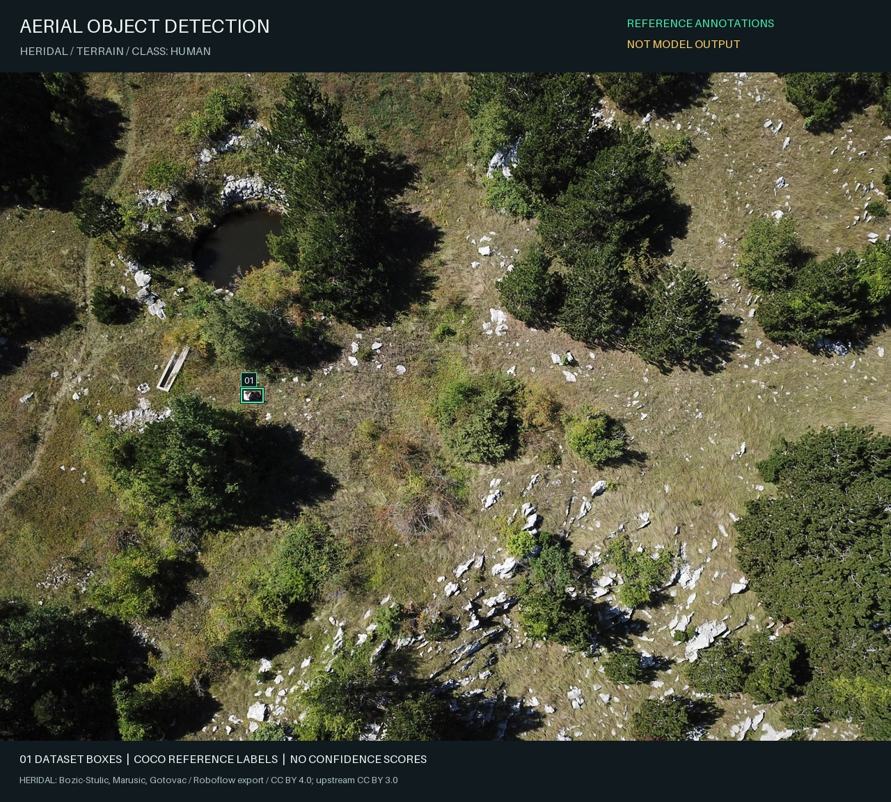
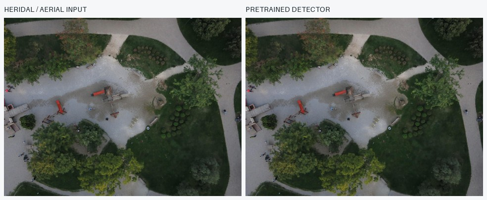
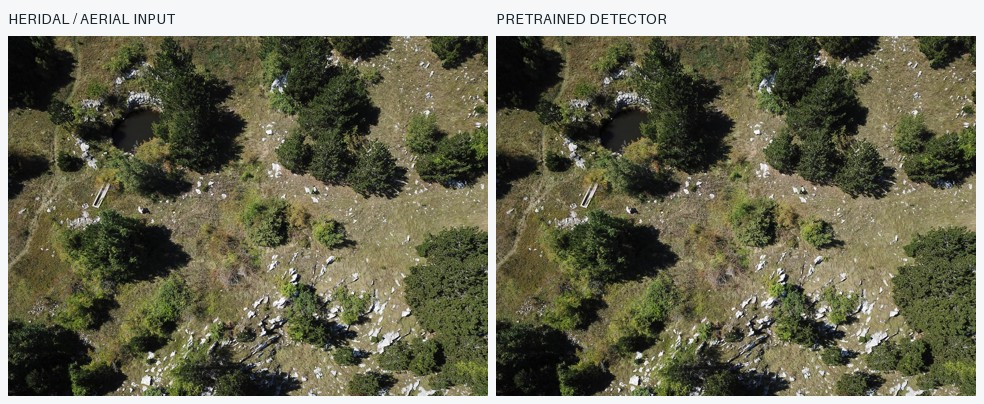
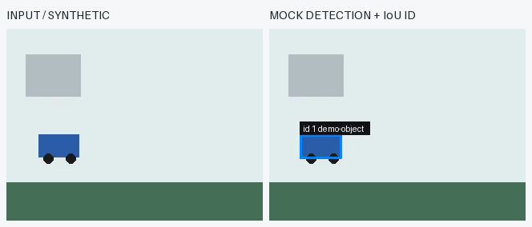
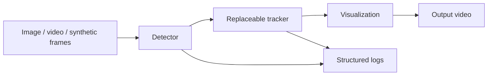

# Aerial Object Detection

A reproducible Python project for offline object detection in civilian aerial
images: COCO data utilities, tiled fine-tuning, image inference, and synthetic
pipeline tests. It is not an onboard drone system or a validated moving-camera
video detector.



**Annotation preview, not model output.** The 15 numbered boxes come directly
from the dataset's COCO labels, scaled with the full frame. They illustrate the
expected box format; no model confidence scores are fabricated. HERIDAL credit:
Bozic-Stulic, Marusic, Gotovac; Roboflow export.
[Media provenance](assets/SAMPLE_SOURCE.md).

<details>
<summary>Second reference example</summary>



</details>

## Preview vs Measured Results

| Material | What it represents |
|---|---|
| Reference images above | Dataset annotations, not inference and not proof of model quality |
| Public COCO baseline | Actual unchanged 320-pixel demo: 0 boxes at threshold 0.50 on both resized samples |
| New local fine-tuning | 535 training images, one epoch, 1,526 steps; mAP 0.1151 to 0.1940 on just 8 validation images / 11 boxes |

The validation subset is small and positive-only. False positives and missed
people remain; these numbers are neither a full benchmark nor historical results.
[Training execution record](docs/validation/TRAINING_VALIDATION.md).

<details>
<summary>Actual pretrained baseline outputs and synthetic pipeline preview</summary>







*Synthetic input alongside the actual pipeline output. Boxes come from a
deterministic mock detector; ID association uses the implemented IoU tracker.*

</details>

## Quick Start

From the repository root, with Python 3.11:

```bash
python3.11 -m venv .venv-level-b
.venv-level-b/bin/python -m pip install --upgrade pip
.venv-level-b/bin/python -m pip install -r requirements.txt
.venv-level-b/bin/python -m pip install -e .
.venv-level-b/bin/aerial-detect run-pipeline --config configs/synthetic_video_demo.toml
```

The demo writes `outputs/synthetic_civilian_tracked.mp4` and frame logs. It
requires no input media, model download, ROS2, GOTURN, or CUDA. Relative paths
in configs are resolved from the working directory, so run from this root.

For pretrained image inference:

```bash
.venv-level-b/bin/aerial-detect infer-image \
  --input assets/aerial/park.jpg \
  --output outputs/aerial_park_detected.jpg \
  --threshold 0.50
```

Repeat with `assets/aerial/terrain.jpg` and
`outputs/aerial_terrain_detected.jpg` for the second scene. Both sample images
are included; the full local dataset is not required.

The first image-inference run downloads public torchvision weights if they are
absent from the Torch cache. This image command is inference only. Optional
new fine-tuning experiments are separate from these original demos.

To reproduce the labeled reference previews, from the repository root:

```bash
.venv-level-b/bin/python scripts/render_reference_previews.py
```

This uses the two included JPEGs and their small COCO annotation subset, not a
model or the full dataset. It writes `docs/media/reference_park.jpg` and
`docs/media/reference_terrain.jpg` with an explicit "NOT MODEL OUTPUT" label.

## Verified Scope

| Component | Evidence and current status |
|---|---|
| COCO dataset utility | Tested: conversion, multiple/empty boxes, validation errors |
| Reference previews | Tested: original COCO boxes scaled to included JPEGs; not model predictions |
| Pretrained image inference | Tested on two included aerial frames, CPU; 0 predictions at 0.50 |
| Video pipeline and IoU tracker | Tested on synthetic frames with mock detections |
| ROS2 helpers | Tested payloads and image-conversion helper; ROS2 runtime unavailable |
| ROS2 node | Implemented, runtime untested; currently uses a mock detector |
| GOTURN | Stub only; installing OpenCV does not enable it |
| Webcam and torchvision video inference | Implemented, not validated end to end |
| Offline fine-tuning | CPU tested: 535 images, 1 epoch, 1,526 steps; checkpoint reload and resume verified |

Software tests and actual runs are documented in the
[validation records](docs/validation/). The GitHub Actions workflow is provided;
its first hosted run is pending publication. Local CPU validation used macOS
arm64 and Python 3.11. Python 3.12 is permitted by package metadata but has not
been validated locally.

## Architecture



The package uses typed protocols, TOML configuration, configurable thresholds,
frame skipping, and generic object IDs. Detailed
[component and sequence diagrams](docs/SYSTEM_ARCHITECTURE.md) describe the
implementation. The optional ROS2 bridge has a separate camera-only interface.

## Provenance

This independently named project grew from an audit of an abandoned prototype.
The archive contained a COCO loader, Faster R-CNN notebooks, and separate
OpenCV/GOTURN experiments. Saved output showed training starting and then being
interrupted. No completed detector checkpoint, historical metrics, deployment,
or detector/tracker/ROS integration was recovered.

All runnable code here is newly written reconstruction work. The loader
preserves historical ideas; the package, CLI, video pipeline, IoU tracker, tests,
and ROS2 bridge are new. A local Heridal export is now present; only two small
attributed full-frame examples are included. The full export is excluded from
Git and is not verified as the exact historical dataset.
This project does not claim affiliation with or continuation of the former team.
See [historical evidence](docs/HISTORICAL_EVIDENCE.md),
[the comparison table](docs/HISTORICAL_VS_RECONSTRUCTED.md), and
[dataset status](docs/DATASET_STATUS.md).

## Tests And Commands

From the repository root:

```bash
.venv-level-b/bin/python -m pytest
.venv-level-b/bin/aerial-detect validate
```

The [runbook](docs/RUNBOOK.md) lists every CLI command, inputs, outputs, separate
test commands, video inference, optional ROS2 checks, and preview regeneration.

## Optional Offline Training

New experiments audit the local HERIDAL export, reserve scene-proxy groups for
validation/test, and fine-tune a separate binary detector on native-resolution
grid crops. The original pretrained demo remains unchanged.

From the repository root:

```bash
.venv-level-b/bin/python -m pip install -r requirements-training.txt
.venv-level-b/bin/python -m pip install -e . --no-deps
.venv-level-b/bin/aerial-train prepare --dataset Heridal.v2-yolo_non_412.coco --output outputs/training/data
.venv-level-b/bin/aerial-train train --config configs/training_local.toml
```

Training needs the ignored local export; the small published samples are not
sufficient. Empty/unverified images are excluded, so validation is positive-only.
Local configuration updates heads for one pass over 535 images, while the
[Colab notebook](notebooks/Aerial_Detection_Training.ipynb) provides a longer CUDA
run with Drive checkpoints. Colab execution is pending your Google session.
The local first pass changed COCO mAP from 0.1151 to 0.1940 on only eight
validation images (11 boxes). This is preliminary subset evidence, not a full
benchmark; false positives and missed people remain. Local checkpoints are not
published, so a fresh clone must train its own before checkpoint inference.
See [training instructions](docs/TRAINING.md) and
[actual execution evidence](docs/validation/TRAINING_VALIDATION.md).

## Publishing

Suggested repository: `aerial-object-detection`. See the
[GitHub commands](docs/GITHUB_HANDOFF.md). Data, trained checkpoints, environments,
and raw outputs are excluded. Only two attributed sample images and their
reference annotation subset are included.

The public distribution and CLI use the neutral name. The local working folder
and internal `falcon_vision_reconstructed` import namespace remain unchanged to
preserve existing environments and experiment paths. Older CLI aliases still
work; names in dated audit/validation records are provenance, not current branding.

## Limits And Scope

- The synthetic demo tests software integration, not detector accuracy.
- The generic pretrained detector missed the objects in both aerial sample
  frames at threshold 0.50; no aerial model accuracy is claimed.
- IoU association is a small baseline tracker; it has no motion model or re-ID.
- Logged frame latency covers detector/tracker work, not total decode/render/encode time.
- The video writer buffers frames in memory and is intended for short demos.
- Real-drone control, navigation, autonomous following, targeting,
  operational surveillance, ONNX export, and deployment are outside this project.

Use public, civilian, synthetic, or otherwise non-sensitive media. See
[safety scope](docs/SAFETY_SCOPE.md) and [current status](PROJECT_STATUS.md).

## License And Attribution

New reconstruction code and original documentation use the [MIT license](LICENSE).
The aerial samples use the export's **CC BY 4.0** declaration, with original
dataset credits, upstream licensing notes, and changes documented in
[SAMPLE_SOURCE.md](assets/SAMPLE_SOURCE.md).
Dependencies, external weights, and datasets retain their own terms; see
[third-party notices](THIRD_PARTY_NOTICES.md).
