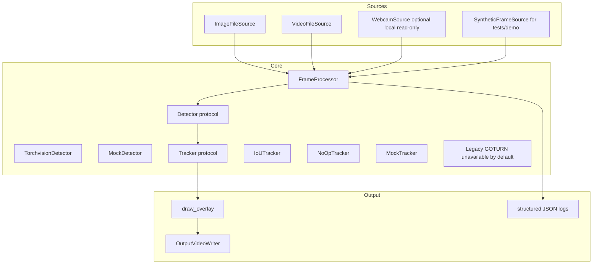
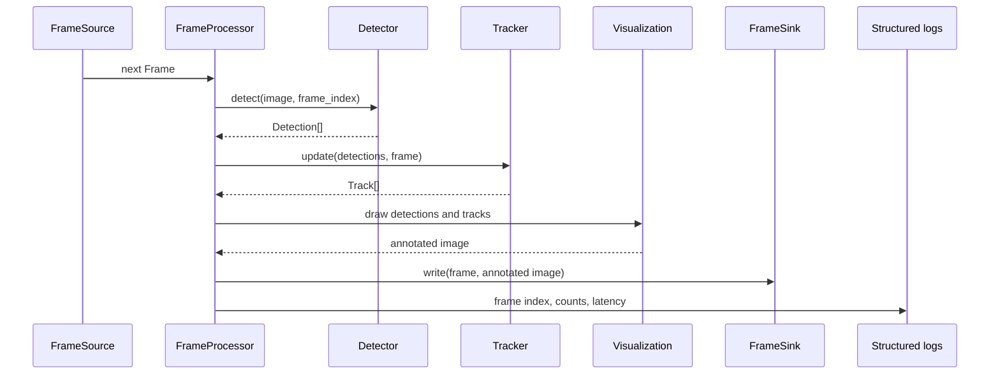
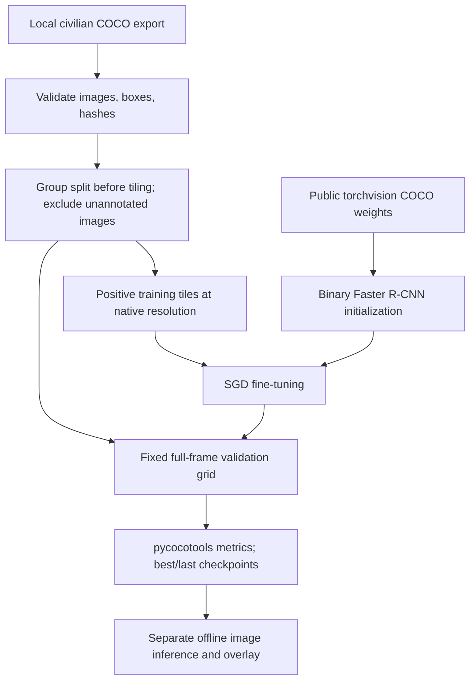

# System Architecture

This document describes the Level B reconstruction and the subsequently added
offline training branch. It is not a historical claim of integration.

## Component Diagram

## Sequence Diagram

## Data Model

- `Frame`: index, timestamp, and PIL RGB image.
- `Detection`: `xyxy` box, class label, class id, confidence.
- `Track`: stable track id, `xyxy` box, class label, confidence, age, missed count.
- `FrameResult`: frame plus detections, tracks, processed flag, and latency.

## Configuration

Pipeline configuration is loaded from TOML through `PipelineConfig`.

Supported knobs include:

- input and output paths;
- source type: image, video, webcam, or synthetic;
- detector backend: torchvision or mock;
- tracker backend: iou, none, mock, or legacy_goturn;
- confidence threshold;
- frame skipping;
- maximum frames;
- FPS;
- IoU threshold;
- track lifecycle;
- log level.

The safe reproducible demo uses `configs/synthetic_video_demo.toml`.

## Separate Offline Training Branch

`training_data.py` owns preparation and crop translation; `training.py` owns
model initialization, training, resume, tiled inference, and COCO evaluation.
TOML configurations distinguish the bounded local pilot, local full training
split, and optional CUDA/Colab run. Checkpoints and data remain Git-ignored.
This branch does not replace the pretrained detector in the Level A/B pipeline
or connect training results to ROS2, tracking, or drone systems. See
[TRAINING.md](TRAINING.md).

## Safety Boundary

The architecture stops at visual perception outputs: detections, tracks, overlays, and diagnostics. It has no interface for navigation, target selection, actuation, mission planning, or command publication.
